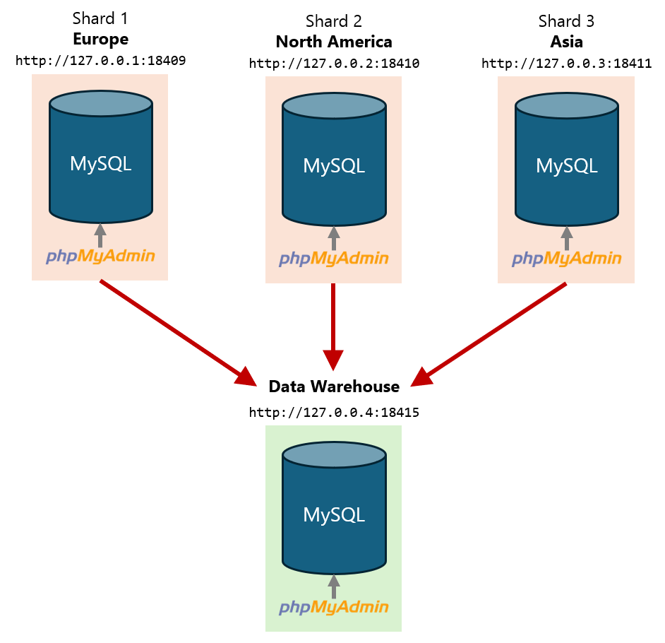

# Data Warehouse
Four independent operational MySQL tenant-based shards plus a separate MySQL data-warehouse destination.

## Topology



The four phpMyAdmin instances are independent browser clients. Each is permanently connected to its MySQL server.

Each one of the first three shards contains customer and invoice information for a specific continent based on **tenant-based sharding**, as in the [Tenant-Based Sharding Demo](https://github.com/arturomorarioja/mysql_sharding_tenant_based).

The fourth shard is the **data warehouse** that will consolidate all data from the other three shards through the extract and load phases of an **ETL** process (Extract, Load, and Transform).

## Containers

- `shard_europe`: MySQL 8.4 database server and phpMyAdmin 5.2.3 for the Europe shard
- `shard_north_america`: MySQL 8.4 database server and phpMyAdmin 5.2.3 for the North America shard
- `shard_asia`: MySQL 8.4 database server and phpMyAdmin 5.2.3 for the Asia shard
- `warehouse`: MySQL 8.4 database server and phpMyAdmin 5.2.3 for the data warehouse

## Usage

1. Run `docker compose up -d`
2. In a browser tab, open the Europe shard: `http://127.0.0.1:18409`
3. In another browser tab, open the North America shard: `http://127.0.0.2:18410`
4. In a third browser tab, open the Asia shard: `http://127.0.0.3:18411`
5. In a fourth browser tab, open the data warehouse: `http://127.0.0.4:18415`
6. Log in in of all them with:

    ```text
    Username: root
    Password: root
    ```
    Database `customer_sharding_by_continent` for the three shards.  
7. From the host, run ```php etl/create-data-warehouse.php```
8. In the data warehouse, the database `customer_data_warehouse` is created and populated with the consolidated data from all three shards

## Considerations

### Database user accounts
- The source ETL account in the three shards is read-only: `warehouse_reader / warehouse_reader`
- The destination account is limited to the warehouse database: `warehouse_writer / warehouse_writer`

### ETL strategy
To consolidate repeated customer and invoice PK values in the shards, the data warehouse uses the following composite source keys:

```text
customers: (continent_id, customer_id)
invoices:  (continent_id, invoice_id)
```

The invoice/customer foreign key is:

```text
(continent_id, customer_id)
    -> customers(continent_id, customer_id)
```

### Transaction handling

Each source shard is read inside a `REPEATABLE READ`, read-only transaction so the rows read from that shard form a stable snapshot during extraction.

The warehouse inserts are performed inside one transaction. If any insert fails, the warehouse load is rolled back.

## Reset

```bash
docker compose down -v --remove-orphans
docker compose up -d
```

## Tools
MySQL 8.4

## Author
ChatGPT 5.6-Sol, prompted by Arturo Mora-Rioja